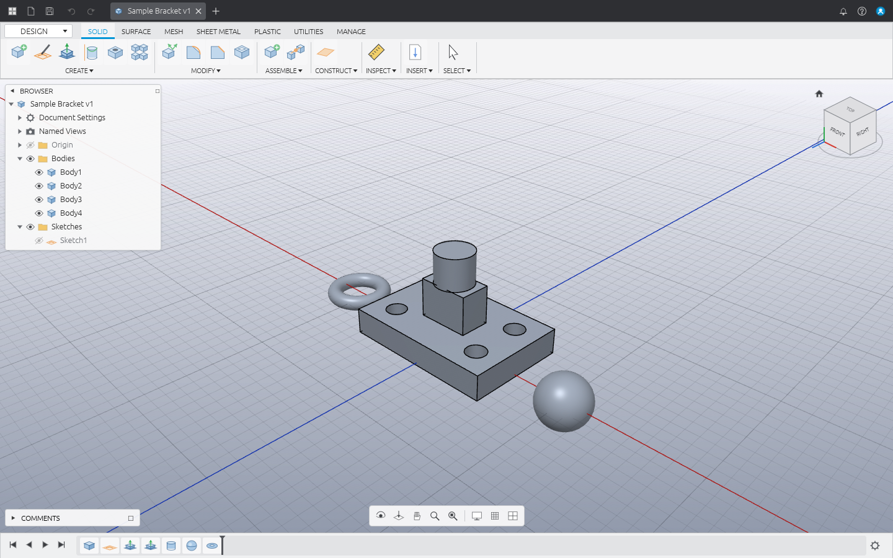

# Merge360

A parametric 3D CAD application written in Rust, modeled on the **Autodesk Fusion 360**
user interface and workflow (offline only, no cloud features).




## Running

```bash
cargo run --release -p merge360            # empty design
cargo run --release -p merge360 -- part.m360   # open a design
```

`Help ▸ Open Sample Design` loads a demo part.

Linux needs a Vulkan (or OpenGL) driver. Under WSL without GPU drivers Merge360 runs on
Mesa's CPU rasterizer (llvmpipe): it then disables MSAA and caps the 3D render resolution
so that fullscreen stays interactive. Set `WGPU_BACKEND=gl` or `vulkan` to force a backend.

## The interface

| Area | What it does |
|------|--------------|
| **Application bar** | Data Panel, File menu (New/Open/Recent/Save/Save As/Export STL·STEP), Save, Undo/Redo, document tabs |
| **Toolbar** | Workspace switcher (DESIGN), tabs SOLID · SURFACE · MESH · SHEET METAL · PLASTIC · UTILITIES · MANAGE, panels with dropdown menus listing every Fusion tool |
| **SKETCH contextual tab** | Line, 2‑point / center rectangle, circle, point, constraints palette, FINISH SKETCH |
| **Browser** | Document Settings (units), Named Views, Origin (planes/axes), Bodies, Sketches, visibility eyes, rename, context menus |
| **Canvas** | Shaded + edges rendering (wgpu, MSAA), adaptive grid, origin planes, hover/selection highlight, window selection (left→right contained, right→left crossing) |
| **ViewCube** | Click faces/edges/corners to snap views, drag to orbit, Home, perspective/orthographic |
| **Navigation bar** | Orbit, Look At, Pan, Zoom, Fit, Display Settings (visual style, environment, camera), Grid & Snaps |
| **Timeline** | Feature history with rollback marker (drag it), playback buttons, double‑click to edit, suppress, rename, delete, error highlighting |
| **Marking menu** | Right‑click radial menu + overflow list |
| **Toolbox** | Press **S** and type to search any tool |

### Working features

* **Sketch** (on origin planes, construction planes or planar faces): line, 2-point / center
  rectangle, circle, 3-point arc, polygon, point; **parametric**: sketch dimensions (lengths,
  distances, diameters) and constraints (horizontal/vertical, coincident, parallel,
  perpendicular, equal, tangent, concentric, fix) solved by a built-in constraint solver;
  drag points with the Select tool; automatic H/V constraints; midpoint, collinear and
  symmetry constraints; center-to-center slot, fit-point spline, ellipse; project body
  edges/faces, extend, break; trim, offset, sketch fillet; mirror (linked by
  symmetry constraints), circular / rectangular pattern, move, scale; sketch text (font
  outlines, extrudable).
* **Create:** Extrude of sketch profiles or planar body faces (push/pull; new body / join / cut /
  intersect, one side or symmetric, taper angle,
  profiles with holes), Revolve (around X/Y/Z or a sketch line), Sweep and Pipe (along connected lines/arcs,
  hollow pipes), Loft, Hole (simple / counterbore / countersink, distance or through all,
  multiple points), Box, Cylinder, Sphere, Torus, Coil (circular / square / triangular
  sections, tapered), Rectangular, Circular & Path Pattern, Mirror —
  all with live preview and drag manipulators.
* **Modify:** Fillet and Chamfer (straight edges between planar faces, incl. face loops),
  Shell (prismatic bodies, open faces), Draft (side faces of prismatic bodies), Thread (cosmetic, ISO metric sizes
  auto-detected from the face), Combine (join / cut / intersect), Split Body, Scale,
  Move/Copy, Press Pull (edges → fillet, profiles → extrude), Delete, Appearance, Physical
  Material (19 materials; mass and center of mass use their densities),
  Change Parameters, Compute All.
* **Surface:** Extrude and Revolve of open or closed sketch curves (lines, arcs, splines), Patch,
  Stitch (closed results become solids), Delete Face, Reverse Normal, Move.
* **Construct:** Offset Plane, Plane at Angle, Midplane, Plane Through Three Points. Sketches,
  holes and planes work on faces of any orientation.
* **Assemble:** Components (new / activate / visibility), Joints (rigid, revolute, slider with
  live motion value).
* **Parameters:** user parameters and expressions (`width * 2 + 5 mm`) for any feature value.
* **Insert:** Insert Mesh (STL, binary/ASCII) as polyhedral bodies that take part in booleans;
  Insert DXF (lines, arcs, circles, polylines with bulges, splines, ellipses) into a new sketch.
* **Inspect:** Measure (edge length, face area, body volume, minimum distance), Interference, Section Analysis
  (with section caps), Center of Mass, Properties.
* **DRAWING workspace:** A3 sheet with title block, Front / Top / Right / Isometric views in
  third-angle layout with hidden-line removal (dashed), true silhouettes of curved faces,
  automatic standard scale, overall dimensions, SVG export.
* **RENDER workspace:** presentation view (environments, soft ground shadow, optional edges) and
  high-resolution image rendering to PNG (HD to 4K).
* **Preferences** (user menu ▸ Preferences, saved in `~/.config/merge360/preferences.ron`):
  language (English, Français, Deutsch, Español — extra or corrected strings can be added in
  `~/.config/merge360/lang/<code>.txt`), keyboard shortcut presets (Fusion 360, Blender,
  SolidWorks) with per-action rebinding, mouse navigation presets (Fusion 360, Blender,
  SolidWorks, Inventor, Tinkercad) with zoom/orbit/pan speed and reversed zoom, interface scale,
  default units, grid/snap defaults, ViewCube, frame-rate display and auto-saved recovery copies.
* **Files:** native `.m360` (RON, full parametric history), STL import, STL and STEP export.
* Fully parametric: every feature is re-editable from the timeline (double-click), roll back with
  the marker, suppress features; undo/redo for everything.

Tools that are not implemented yet (modeled threads, the Animation / Simulation /
Manufacture / Generative Design workspaces, …) are present
in the UI and report “not available yet”. Kernel limitations (truck): fillets meeting three at a
corner, shells of non-prismatic bodies and booleans of exactly coplanar faces may fail; such
features turn red in the timeline with an explanation.

### Mouse & keys (Fusion defaults)

| Input | Action |
|-------|--------|
| Middle drag / Shift + middle drag / wheel | Pan / Orbit / Zoom at cursor |
| Left click / double click | Select face or profile / select body |
| Right click | Marking menu |
| S | Toolbox |
| E, M, I, A | Extrude, Move, Measure, Appearance |
| L, R, C, P (in sketch) | Line, Rectangle, Circle, Point |
| Enter / Esc / Delete | Repeat last command / cancel / delete |
| F6 | Fit |
| Ctrl+Z / Ctrl+Y / Ctrl+S / Ctrl+O / Ctrl+N | Undo / Redo / Save / Open / New |

## Architecture

```
crates/
  m360-kernel   B-rep geometry on the pure-Rust `truck` kernel: primitives, profile
                extrusion, booleans, tessellation (with smooth/seam edge filtering), STL/STEP
  m360-core     Document model: features, timeline + marker, incremental regeneration
                cache, undo/redo, units, sketch profile detection, .m360 persistence
  m360-render   wgpu offscreen renderer: shaded meshes, screen-space thick edges, grid,
                overlays, orbit camera
  m360-ui       egui application (Fusion-style layout, commands, sketching, picking)
app/            `merge360` binary
```

## Development

```bash
cargo test            # kernel, document, and sample-design tests
cargo clippy --all-targets
```

Dev hooks (environment variables) used for automated visual checks:

* `M360_SAMPLE=1` — open the sample design
* `M360_SCREENSHOT=out.png` — save a screenshot after 40 frames and exit
* `M360_FULLSCREEN=1` — start fullscreen; `M360_FPS=1` — print frame rate
* `M360_WAYLAND=1` — use native Wayland under WSLg (by default Merge360 uses XWayland there:
  WSLg's Weston crashes on native Wayland windows when hi-DPI scaling is enabled)
* `M360_CAMERA="yaw,pitch,dist,tx,ty,tz"` — set the initial camera
* `M360_SCRIPT=file` — replay scripted input (see `crates/m360-ui/src/script.rs`)
* `M360_STYLE=wire` — start in wireframe
